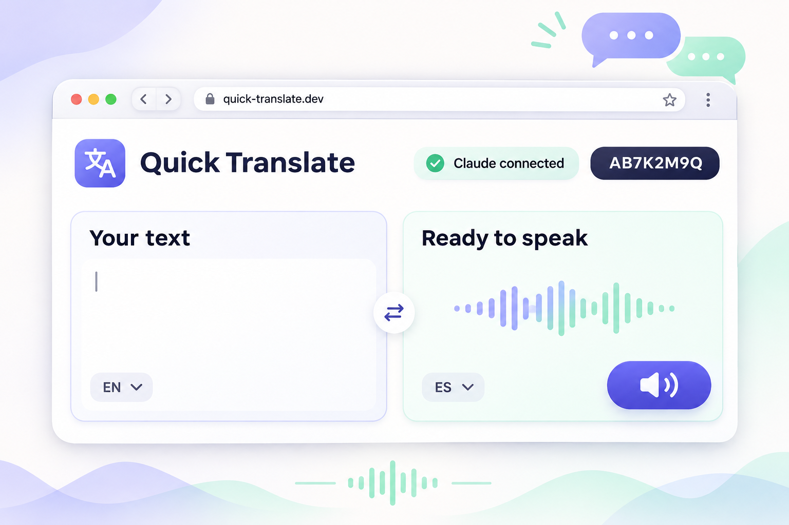
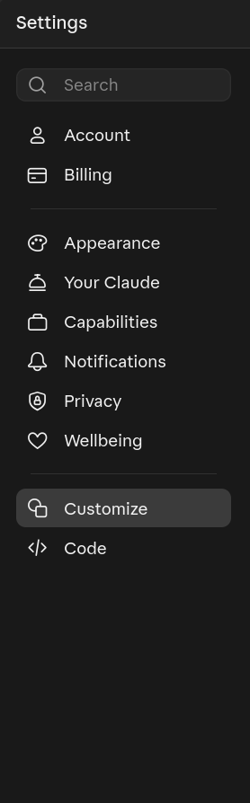
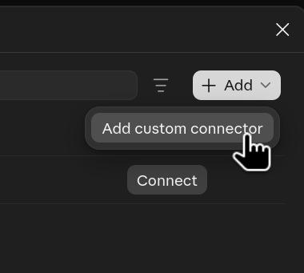
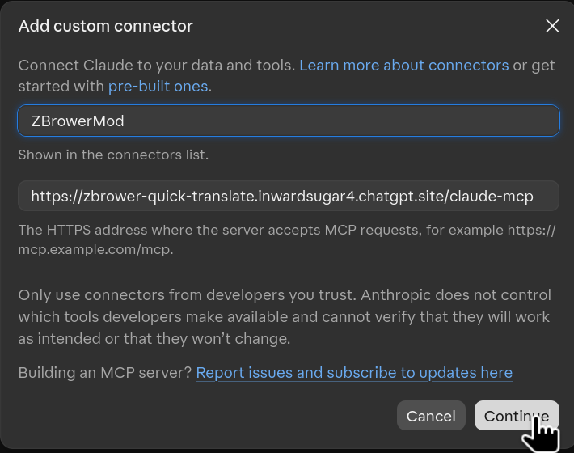
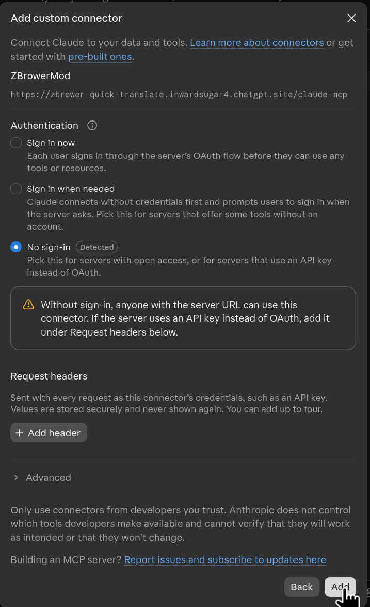
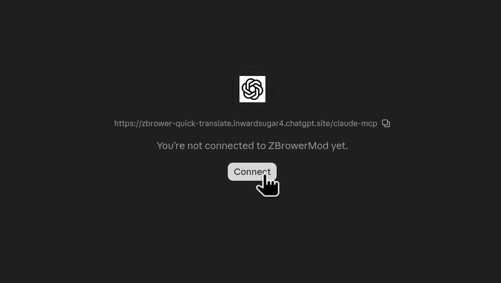
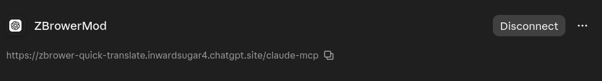

<div align="center">

# Quick Translate

### Let Claude write. Listen from your browser.

Send Claude's response to a lightweight page, then read it on screen or play it aloud with your browser's voice.

[Open Quick Translate](https://zbrower-quick-translate.inwardsugar4.chatgpt.site) · [Connect Claude](#connect-claude) · [How it works](#how-it-works)



</div>

## Connect Claude

### Add the connector in Claude

In Claude on the web, open **Settings** → **Customize**. In the connectors area, choose **Add** → **Add custom connector**.

| Open Claude Settings and select Customize | Choose Add custom connector |
|:--:|:--:|
|  |  |

In **Customize**, choose **Add** → **Add custom connector**.

Enter a name such as `ZBrowerMod` and this server URL:

`https://zbrower-quick-translate.inwardsugar4.chatgpt.site/claude-mcp`

Then select **Continue**.



On the authentication screen, leave **No sign-in** selected and click **Add**. This connector uses a channel code to route messages instead of a Claude account sign-in.



Open the new `ZBrowerMod` connector and click **Connect**. When Claude shows it as connected, the setup is complete.





### Send text to Quick Translate

1. Open [Quick Translate](https://zbrower-quick-translate.inwardsugar4.chatgpt.site) in a browser tab and create a channel.
2. Copy the eight-character channel code shown on the page.
3. In a Claude chat, enable the `ZBrowerMod` connector if Claude asks which connectors to use.
4. Ask Claude to send text to Quick Translate using the **Display text in Quick Translate** tool. Include the channel code and the exact text (for example: “Send `hello` to Quick Translate using channel `ABCD1234`.” Replace that example code with your own).
5. The page receives the text. Select the voice language and press **Listen** to hear it.

If Claude says it cannot find the tool, check **Settings** → **Customize** and confirm `ZBrowerMod` is connected, then start a new chat and enable the connector for that chat.

## How it works

Quick Translate is a small companion display for reading and listening to Claude responses. It does not translate text automatically; Claude can translate it when you ask, then send the result to your paired page.

- **No Quick Translate account:** open the public page and create a temporary channel.
- **Private pairing code:** each channel uses a random eight-character code.
- **Live delivery:** Claude sends text through the remote MCP connector and the page checks for updates.
- **Listen aloud:** the Listen button streams speech from Google Translate. Text you play is sent to Google to create the audio. **Preview voice** in Voice settings uses your browser's built-in voices.
- **Short retention:** channels expire after 24 hours; their latest message is removed after 15 minutes.

Treat the channel code like a password: anyone who has it can send text to that page. The service stores a hash of the code, not the code itself.

### No sound?

Open the page directly in a browser tab, press **Listen**, and check your device's media volume. If the page reports that a voice is unavailable, choose another voice under **Voice settings** or install a speech voice for that language on your device.

## Run locally

The hosted application is in [`sites/quick-translate`](sites/quick-translate). It uses Cloudflare Workers and D1.

```sh
cd sites/quick-translate
npm install
npm run build
node --test lib/channel-store.test.js
```

To connect Claude, the MCP endpoint must be deployed at a public HTTPS URL. See the [implementation notes](docs/superpowers/specs/2026-11-09-claude-translate-display-design.md) for architecture details.
